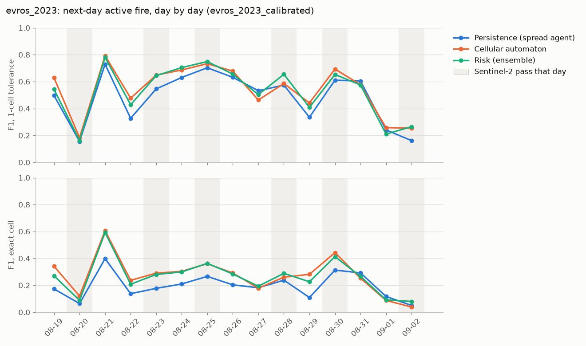

# Case study: Evros (Alexandroupolis) fire, Greece, August–September 2023

## Decision

The case-study fire is **Evros 2023**. It is the largest wildfire recorded in the EU, and it burned from 19 August to early September 2023 in north-eastern Greece.

The second fire, used to test how well the system generalises, is **Evia 2021**. It falls within the Mesogeos years (2006–2022).

## How it was chosen

Seven Mediterranean fires were scanned with FIRMS VIIRS (S-NPP, standard processing), counting hotspots inside a box around each fire:

| candidate | hotspots | days with ≥ 30 | comment |
|---|---|---|---|
| Tunisia, Tabarka 2023 | 119 | 2 | too small for day-to-day spread |
| Algeria, Béjaïa 2023 | 407 | 2 | one explosive day, scattered fires |
| Algeria, Kabylie 2021 | 3524 | 4 | one explosive day (2547), many ignitions |
| Greece, Evia 2021 | 4092 | 6 | compact, multi-day; in Mesogeos |
| **Greece, Evros 2023** | **4230** | **14** | longest growth sequence |
| Greece, Rhodes 2023 | 953 | 6 | compact, smaller |
| Turkey, Manavgat 2021 | 2721 | 9 | only one Sentinel-2 scene during the fire |

The four strongest candidates were then checked for Sentinel-2 coverage and clouds (SCL).

Evros has a clear pre-fire scene (3 August, 3 % cloud) and **six usable scenes during the fire**: 20 August, 23 August, 25 August, 28 August, 30 August and 2 September. Some of them cover only part of the area.

Evia's scenes during the fire show 25–46 % "cloud". This is probably thick smoke flagged as cloud by SCL.

## Setup

| item | value |
|---|---|
| common grid | 193 × 175 cells at 375 m, EPSG:32635 (72 × 66 km) |
| optical | Sentinel-2 L2A at 23.4 m: pre-fire 2023-08-03; during the fire on 6 of the 15 forecast days |
| weather | ERA5-Land, mean 09–16 UTC of each day |
| terrain / cover | Copernicus DEM GLO-30 (2024_1), ESA WorldCover v200 |
| fire on day t | VIIRS hotspots (S-NPP + NOAA-20) of day t |
| ground truth | VIIRS hotspots (nominal + high) of day t+1, rasterised at 375 m |
| forecast days | 2023-08-19 → 2023-09-02 (15 days) |

The system runs day after day with **one coordinator**, as in operation. On the 9 days without a Sentinel-2 pass, the fire comes from FIRMS only, and the smoke and burned-area layers fall back on their last known version. The burned area is also completed with the fire seen on the previous days.

```powershell
python scripts/build_sequence.py --name evros_2023 --bbox 25.65 40.74 26.50 41.32 --fire-start 2023-08-19 --start 2023-08-19 --end 2023-09-02
python scripts/run_sequence.py --sequence data/sequences/evros_2023 --split-date 2023-08-25
python scripts/calibrate_ca.py --sequence data/sequences/evros_2023 --runs outputs/evros_2023 --train-end 2023-08-25
python scripts/run_sequence.py --sequence data/sequences/evros_2023 --split-date 2023-08-25 --config configs/evros_2023_calibrated.yaml --out outputs/evros_2023_calibrated
python scripts/run_sequence.py --sequence data/sequences/evros_2023 --split-date 2023-08-25 --config configs/evros_2023_calibrated.yaml --out outputs/evros_2023_calibrated_no_s2 --without-optical --no-quicklook
```

## Results: next-day active fire, pooled over days (micro average)

Every model is still a baseline: no neural network is trained yet. **F1@1** accepts a 1-cell (375 m) error, which is fairer for thin fire fronts. Exact-cell F1 is also reported.

**All 15 days**

| forecast | precision | recall | F1 | F1@1 |
|---|---|---|---|---|
| persistence ("tomorrow = today") | 0.239 | 0.225 | 0.232 | 0.489 |
| cellular automaton, paper coefficients | 0.221 | 0.635 | 0.328 | 0.562 |
| **cellular automaton, calibrated** | 0.250 | 0.572 | **0.348** | **0.575** |
| risk = ensemble (persistence + calibrated CA) | 0.274 | 0.436 | 0.336 | 0.556 |

**Test days only** (26 Aug – 2 Sep, never seen by the calibration of 19–25 Aug)

| forecast | precision | recall | F1 | F1@1 |
|---|---|---|---|---|
| persistence | 0.217 | 0.240 | 0.228 | 0.510 |
| cellular automaton, paper coefficients | 0.142 | 0.685 | 0.236 | 0.502 |
| **cellular automaton, calibrated** (3 steps/day, p_h 0.4, c1 0.1, c2 0.131) | 0.175 | 0.608 | **0.272** | **0.546** |
| risk (persistence + calibrated CA) | 0.200 | 0.436 | 0.274 | 0.542 |

**Does Sentinel-2 help? Ablation on the 6 days that had a pass** (calibrated CA)

| fire layer | persistence F1 | CA F1 | risk F1 | CA F1@1 |
|---|---|---|---|---|
| Sentinel-2 + FIRMS (full system) | 0.160 | **0.269** | **0.244** | **0.466** |
| FIRMS only (optical scene removed) | 0.154 | 0.235 | 0.216 | 0.424 |

Day by day (regenerated by `run_sequence.py` in `outputs/evros_2023_calibrated/summary.png` and `summary.md`):



## What the real data taught us (and what was fixed)

1. **Time matters in fusion.** Sentinel-2 is a 09:18 UTC snapshot, while FIRMS keeps detecting until about 23:50 UTC. Hotspots later than the optical scene are now added on top instead of being rejected by it (`fire_firms_new`).
2. **The Sentinel-2 fire test needed a stricter threshold.** The Landsat thresholds (SWIR2 ≥ 0.15) flag dark fresh char as fire on surface reflectance: on 2 September only 6 % of the detections matched FIRMS. With SWIR2 ≥ 0.25, 96 % of the FIRMS-confirmed detections are kept and 83 % of the unconfirmed ones are removed. This was checked against same-day FIRMS, not against the forecast truth.
3. **The burned area must follow the fire between optical passes.** Otherwise the CA spreads back into fuel that is already gone. The coordinator now adds the fire of previous runs to an older dNBR map.
4. **Days with Sentinel-2 score lower overall, but because of which days they are.** They include 20 August (the fire jumped from 137 to 1173 cells) and the extinction on 2 September. On the same days, removing Sentinel-2 lowers every score (table above).
5. **Calibration mainly fixes the spread rate** (3 CA steps per day instead of 4). The other coefficients lie on a plateau. On unseen days it gains +0.04 F1 and cuts the over-prediction (precision 0.14 → 0.18).
6. **The equal-weight ensemble does not beat the calibrated CA alone.** Its weights should be learned on the calibration days instead of fixed at 0.5 / 0.5.

## Limits to state in the report

- One fire only. The CA calibration uses a temporal split within the same fire, and the SWIR threshold was checked on the same fire. **Evia 2021 must confirm both.**
- The truth is FIRMS: detections, not perimeters, with omissions under thick smoke and at small fires.
- Explosive days (20 → 21 August) are not predictable from the day before with these inputs.
- dNBR flags harvested fields in the Evros river plain as burned (cropland mask or the CaBuAr U-Net needed).

## Next

1. Run the same commands on **Evia 2021** (generalisation, Mesogeos years).
2. Train the **spread U-Net** (Next Day Wildfire Spread / WildfireSpreadTS) on the layers our agents produce, and add it to these tables.
3. Learn the **ensemble weights** on the calibration days.
4. Phase 5: dashboard on top of `outputs/`.
