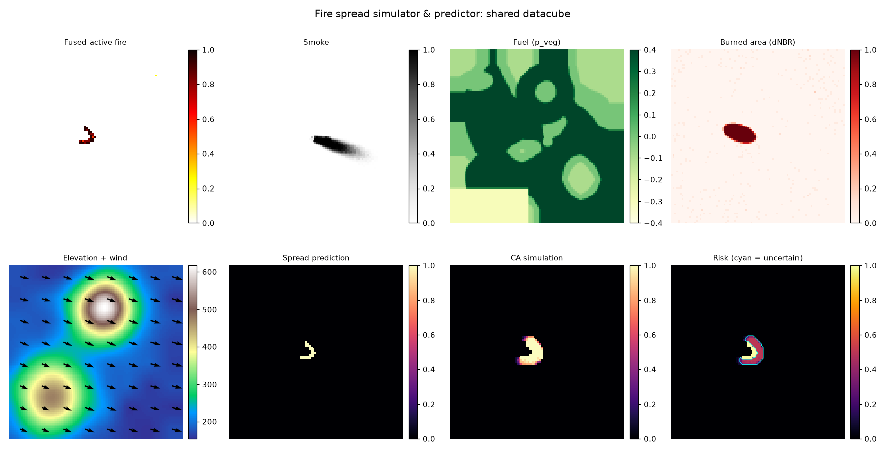
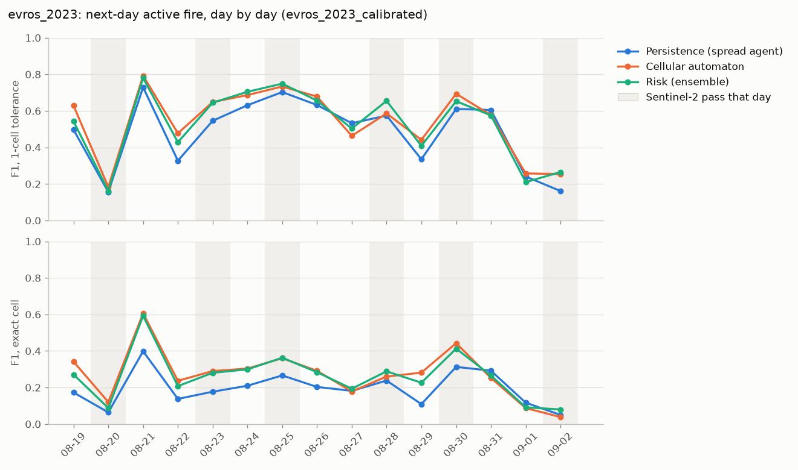

# Progress Report: Fire Spread Simulator & Predictor

*Sup'Com computer vision project. Status as of 17 November 2026.*

## 1. Summary

The full system is built and runs from start to finish.

- **Perception agents** read satellite data and detect five things: active fire, smoke, fuel (vegetation), burned area, and environment (wind and terrain).
- **Two forecasters** predict the next day's fire:
  - a learned-model slot, which currently holds a baseline;
  - a physical fire-spread simulation (a cellular automaton).
- **A coordinator** combines everything on one common grid. It produces a risk map, flags uncertain zones and writes alerts.

The system has been tested in two ways:

- on a **synthetic scene**, which lets the whole pipeline run without any downloaded data;
- on a **real case study**: the Evros fire (Greece, August 2023, the largest wildfire recorded in the EU), forecast day by day over 15 days.

**No neural network is trained yet.** Each agent currently uses a *baseline* that needs no training: published spectral indices, fixed thresholds and a physical model. Every agent already has a slot for a trained model. Training needs a GPU machine (VM), which is not available yet. It also needs the large public training datasets listed in section 5, which will be downloaded onto that machine. The baselines give us reference scores that each trained model will have to beat.

## 2. Architecture

```
Scene (one area, one date): Sentinel-2 before/after · FIRMS hotspots · ERA5 weather · DEM · WorldCover
        │
        ▼
COORDINATOR runs the perception agents:
  fire ─ smoke ─ vegetation ─ burned_area ─ environment
  every output is resampled onto ONE common grid (UTM, 375 m) = shared "datacube"
        │
        ├──► Spread agent      (data-driven forecast: persistence now, U-Net later) ─► spread_prob
        └──► Simulation agent  (Alexandridis cellular automaton, Monte Carlo)       ─► sim_prob
        │
        ▼
Fusion ─► risk map, disagreement / uncertain zones, alerts, report
```

| Agent | Role | Current method (no training) | Planned trained model |
|---|---|---|---|
| Fire | Detect where it is burning now | Active-fire test on Sentinel-2 short-wave infrared bands (Murphy et al. 2016, adapted), fused with NASA FIRMS hotspots | U-Net (Landsat-8 Active Fire → Sen2Fire) |
| Smoke | Detect the smoke plume and its direction | Haze index; plume direction checked against the wind | U-Net (USTC_SmokeRS + our own labels) |
| Vegetation | Map the fuel | WorldCover land-cover lookup + NDVI (a vegetation index) | Classifier (EuroSAT) |
| Burned area | Map the burn scar | dNBR (difference of the Normalized Burn Ratio before and after the fire) | U-Net (CaBuAr) |
| Environment | Wind, humidity, temperature, slope | ERA5 weather data + DEM (terrain model) | — (input data) |
| Spread | Predict the active fire on day t+1 | Persistence baseline ("tomorrow = today") | U-Net / ConvLSTM (Next Day Wildfire Spread, WildfireSpreadTS) |
| Simulation | Simulate physical fire spread | Alexandridis et al. (2008) cellular automaton, coefficients calibrated on real data | — (physical model) |

**Design choices**

- **One scene, one grid.** All agents write to the same datacube, so their outputs can be compared and fused directly.
- **Robustness.** If an agent fails or its image is too cloudy, the coordinator reuses the last known layer, marks it as *stale*, and the run continues. Clouds are stored as "not observed", which is different from "no fire".
- **Plug-in models.** Each agent has a `checkpoint:` entry in the config. Pointing it at a trained model file replaces the baseline, and no other code changes.
- **Ablation built in.** Any agent can be switched off to measure how much it contributes.

## 3. Work completed

1. **Core framework**:
   - a common message format between agents;
   - the common grid, with resampling onto it;
   - the shared scene datacube;
   - the base agent class, which handles fallback when an agent fails.
2. **All seven agents**, each with a working baseline.
3. **Coordinator**:
   - fusion of the fire layers, weighted by confidence and by how recent each observation is;
   - the ensemble risk map, with uncertainty flags and alerts;
   - a Markdown report and a summary figure for each run.
4. **Synthetic scene generator**, used to test the whole pipeline without real data.
5. **Real-data pipeline**:
   - Google Earth Engine and FIRMS clients;
   - building a scene for one day, or a sequence of daily scenes;
   - FIRMS hotspots of the next day used as ground truth.
6. **Evaluation**:
   - precision, recall, F1, IoU and AUC-PR;
   - a tolerant F1@1 that accepts a one-cell (375 m) error;
   - day-by-day evaluation and an ablation study.
7. **Calibration** of the cellular automaton's coefficients on real fire days, by grid search with a train/test split in time.
8. **Case-study selection.** Seven Mediterranean fires were screened, and Evros 2023 was chosen (see [case_study.md](case_study.md)).
9. **Deep-learning tooling**:
   - U-Net builder;
   - focal + Dice loss for rare fire pixels;
   - saving and loading model files, together with each model's input channels and normalisation statistics.
10. **Test suite** (pytest): 29 tests pass and 1 is skipped. A Streamlit dashboard skeleton also exists.

## 4. Results so far

### 4.1 Synthetic scene (pipeline check)

Command: `python scripts/run_pipeline.py --scene data/scenes/synthetic`

| Forecast | Precision | Recall | F1 | F1@1 |
|---|---|---|---|---|
| Spread (persistence) | 0.697 | 0.287 | 0.407 | 0.806 |
| Simulation (cellular automaton) | 0.609 | 0.975 | 0.750 | 0.947 |
| **Risk (ensemble)** | 0.722 | 0.812 | **0.765** | **0.983** |

Ablation on the risk map: the full system scores F1 0.765. Without vegetation it drops to 0.647, without burned area to 0.710, and without environment to 0.743. Without smoke it stays at 0.765, because smoke only serves as a consistency check (plume direction against wind) and is not used in the forecast.



### 4.2 Real case study: Evros 2023 (15 forecast days)

Calibration uses 19–25 August. The test days (26 August – 2 September) were never seen during calibration.

| Forecast (test days) | Precision | Recall | F1 | F1@1 |
|---|---|---|---|---|
| Persistence | 0.217 | 0.240 | 0.228 | 0.510 |
| Cellular automaton, paper coefficients | 0.142 | 0.685 | 0.236 | 0.502 |
| **Cellular automaton, calibrated** | 0.175 | 0.608 | **0.272** | **0.546** |
| Risk (persistence + calibrated CA) | 0.200 | 0.436 | 0.274 | 0.542 |

- **Calibration helps on unseen days.** F1 rises by +0.04 and over-prediction falls (precision goes from 0.14 to 0.18).
- **Sentinel-2 adds value.** On the 6 days with a satellite pass, removing the optical image lowers every score. For example, the calibrated CA's F1 drops from 0.269 to 0.235.
- **Fixes driven by real data:**
  - Hotspots seen after the satellite pass are now added on top of the Sentinel-2 fire map instead of being rejected by it.
  - The Sentinel-2 fire threshold was made stricter, because the original one flagged freshly burnt ground as active fire.
  - The burned-area map is now updated between satellite passes using the fire seen on previous days.



Full details are in [case_study.md](case_study.md).

## 5. Remaining work

### 5.1 Waiting for the VM (GPU and storage)

1. **Download the training datasets** into `data/raw/` (see `data/README.md`). WildfireSpreadTS alone is about 48 GB.
2. **Write the training script** for the spread model: load the public dataset, keep only the input layers our agents produce, train a U-Net with the focal + Dice loss, and save it with `save_checkpoint`. This script does not exist yet; the helper functions it needs do.
3. **Train the spread U-Net**, then a ConvLSTM, on Next Day Wildfire Spread / WildfireSpreadTS. Plug it in through `agents.spread.checkpoint` and add it to the Evros tables. Target: beat persistence (F1 0.228) and the calibrated CA (F1 0.272) on the test days.
4. **Train the perception U-Nets** and replace their baselines:
   - fire (Landsat-8 Active Fire → Sen2Fire);
   - smoke (USTC_SmokeRS + our own labels);
   - burned area (CaBuAr);
   - vegetation (EuroSAT).

   Each trained model must beat its baseline.

### 5.2 Can be done without the VM

5. **Second fire, Evia 2021.** Check that the CA calibration and the stricter Sentinel-2 threshold also work on a fire they were not tuned on.
6. **Learn the ensemble weights** on the calibration days instead of using a fixed 50/50 split. With fixed weights, the ensemble does not yet beat the calibrated CA alone.
7. **Cropland mask** so that harvested fields are not flagged as burned by dNBR.
8. **Dashboard** (Streamlit) built on top of `outputs/`.
9. **Final report**: benchmark tables (baseline vs. trained), ablation study, limitations.

## 6. Known limitations

- **Only one real fire so far.** The calibration and the threshold choice must be confirmed on Evia 2021.
- **The ground truth is FIRMS hotspots, not fire perimeters.** Hotspots are missed under thick smoke and on small fires.
- **Explosive days cannot be predicted** from the previous day with these inputs. For example, the fire grew from 137 to 1173 cells between 20 and 21 August.
- **The scores are baselines.** They are the reference that the trained models must beat, not the final performance.

## 7. How to reproduce

```powershell
python -m venv .venv
.\.venv\Scripts\Activate.ps1
pip install -e ".[dev,app]"

python scripts/make_synthetic_scene.py
python scripts/run_pipeline.py --scene data/scenes/synthetic          # report + quicklook in outputs/synthetic/
python scripts/run_ablation.py --scene data/scenes/synthetic --layer risk
pytest
streamlit run app/streamlit_app.py
```
